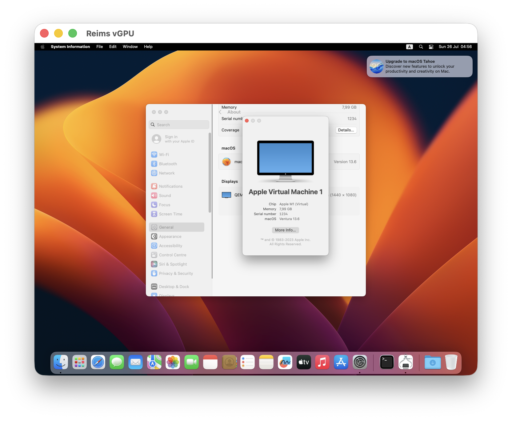
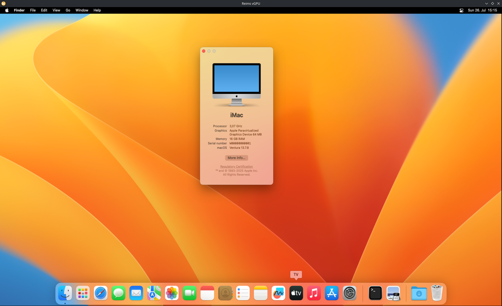

# reims-vgpu

[](LICENSE) [](https://discord.gg/D2AM9mrDgs)

> **Beta.** The C API has largely stabilized, and it changes only by addition
> ([docs/api.md](docs/api.md) section 1). The work now is on platform- and driver-specific
> differences, so what you see can still vary between hosts and their GPUs. `reims-ctl` and its VM
> settings, QEMU's device options, the crate layout and the supported host/guest pathways may still
> change without a compatibility guarantee.

reims-vgpu is an experimental virtual GPU for macOS guests. It lets macOS running inside a VM use
accelerated graphics instead of a basic framebuffer, with the guest operating system unchanged.

macOS already includes a paravirtual GPU driver named `AppleParavirtGPU.kext`, written against the
host side Apple ships as `ParavirtualizedGraphics.framework`. reims-vgpu is that host side, in its
place: a Rust library, `libreims_vgpu`, with a C API. It takes the guest's GPU command stream and
runs it on Metal on a Mac, or on Vulkan on Linux through
[`metal2vulkan`](https://github.com/steelbrain/metal2vulkan), and can draw each guest display into
a window of its own. QEMU's `apple-gfx` devices link it, on a Mac as on Linux. There is no custom
macOS kext and no guest driver to install.

Contributions are welcome. I am especially interested in collaborating with developers who want to
work on correctness, visual glitches, synchronization bugs, command-stream decoding, Metal/Vulkan
translation, and making more host/guest combinations reliable.



*arm64 macOS 13 Ventura guest on an Apple Silicon host.*



*x86_64 macOS 13 Ventura guest on a Linux host.*

## Three pathways

| Pathway | Host | Guest | QEMU machine and device | Platform | Run with |
|---|---|---|---|---|---|
| **x86-64 macOS / Linux Vulkan** | x86-64 Linux (KVM) | x86-64 macOS | `q35` through OpenCore, PCI `apple-gfx-pci` (`106b:eeee`) with its option ROM | **Vulkan** through metal2vulkan | `reims-ctl` |
| **arm64 macOS / macOS Metal** | Apple silicon Mac (HVF) | arm64 macOS | `vmapple`, MMIO `apple-gfx-mmio` | **Metal** | `reims-ctl`, or `make vm` |
| **arm64 macOS / macOS Vulkan** | Apple silicon Mac (HVF) | arm64 macOS | `vmapple`, MMIO `apple-gfx-mmio` | **Vulkan** through metal2vulkan, on MoltenVK | QEMU configured on `cargo xtask dist --platform vulkan`'s tree |

On a Mac, Metal is the product and the default, and `reims-ctl` runs on it. The Vulkan platform
builds there too, into `target/dist-vulkan`, so the smoke, the suite and a QEMU configured on that
tree can run on it beside the Metal one.

- The library: `crates/`. Core holds all behavior, generic over its platform; beside it are the
  Metal and Vulkan platforms, a display's window, the Rust API and the C API
  ([Crates](#crates)).
- QEMU: `vendor/qemu` tracks
  [`steelbrain/qemu-reims-vgpu@steelbrain/reims-vgpu`](https://github.com/steelbrain/qemu-reims-vgpu/tree/steelbrain/reims-vgpu):
  `apple-gfx` in C on the C API, which finds the library through pkg-config and links it
  statically.
- The option ROM: `firmware/`, the PCI device's UEFI driver, in C, which an x86-64 guest's
  firmware runs.
- The Vulkan platform's runtime: metal2vulkan's public repository, at the commit the workspace's
  `Cargo.toml` names. On macOS it runs on MoltenVK.
- VMs: `reims-ctl` (`crates/reims-ctl`) creates, boots and manages them.

## Getting started

This tree ships the library, QEMU on it and `reims-ctl`, **not a ready-made macOS disk image**: you
bring the guest. On an Apple silicon Mac that is an IPSW, or a VM made with macosvm or tart; on
Linux, an OpenCore image with an installer or a disk already installed. On an M3 Max, arm64 macOS
13.6, 14.6.1, 15.6.1 and 26.6.2 guests reach their desktops; x86-64 guests were measured with
macOS 26.6.1 on an RTX 5080 Laptop GPU ([docs/qemu.md](docs/qemu.md)).

### Install reims-ctl

Clone the repository (without `--recursive`: QEMU's own submodules are not needed) and run:

```sh
scripts/install-ctl.sh
```

It installs what the build needs (Homebrew on macOS; apt on Ubuntu and Debian, pacman on Arch and
CachyOS; Rust through rustup.rs), fetches `vendor/qemu`, builds the library and QEMU on it, installs
QEMU into `~/.local/share/reims-ctl/qemu`, and `reims-ctl` into `~/.cargo/bin`. `vendor/qemu` is
fetched from its public repository (`steelbrain/qemu-reims-vgpu`), at the commit this checkout
pins, and Cargo fetches metal2vulkan from its public repository, at the commit the workspace's
`Cargo.toml` names. `reims-ctl doctor` checks the host and the install.

### arm64 guest on an Apple silicon Mac (HVF / vmapple)

QEMU's `vmapple` machine boots what Virtualization.framework makes, so a guest comes from an IPSW
or from an existing Virtualization.framework VM. There is no OpenCore step.

```sh
reims-ctl create mac --ipsw latest              # install the newest macOS this Mac supports (a 64G disk)
reims-ctl create mac --ipsw ~/Downloads/UniversalMac.ipsw   # or a given IPSW
reims-ctl create mac --bundle ~/VMs/macos13     # or import a macosvm or tart VM (an APFS clone)
reims-ctl start mac                             # a window opens for each guest display
```

`make vm VM=path/to/macosvm-vm` boots a macosvm VM on `make qemu`'s QEMU without `reims-ctl`
([QEMU and a VM](#qemu-and-a-vm)).

### x86-64 guest on Linux (KVM)

1. **Host prep.** You need KVM (`/dev/kvm`) and a Vulkan driver; `reims-ctl gpus` lists the GPUs a
   VM can be given. The library's views of guest memory take a kernel mapping for each run of
   guest pages, so raise `vm.max_map_count`: `sudo sysctl -w vm.max_map_count=1048576` covers a
   12 GiB guest, and a file in `/etc/sysctl.d` keeps it. `scripts/install-ctl.sh` and `reims-ctl`
   warn when it is too low.

2. **Get OpenCore and an installer with [OSX-KVM](https://github.com/kholia/OSX-KVM)** (or ULTMOS).
   Follow that project's docs to fetch the recovery image and build OpenCore. You only need its
   pieces, not its launcher: `reims-ctl` copies the OpenCore image into the VM and finds OVMF beside
   it, or uses QEMU's own.

   ```sh
   reims-ctl create mac --opencore ~/OSX-KVM/OpenCore/OpenCore.qcow2 \
     --installer ~/OSX-KVM/BaseSystem.img       # a new 128G disk
   reims-ctl create mac --from-script ~/OSX-KVM/OpenCore-Boot.sh   # or take all a launch script names
   reims-ctl start mac
   ```

   `--disk` uses an existing disk instead (copied, reflinked where the file system can; as a qcow2
   overlay; or in place), and `reims-ctl eject mac` takes the installer out once macOS is
   installed.

3. **Set Metal's error mode in the guest**, once:

   ```sh
   sudo defaults write /Library/Preferences/.GlobalPreferences METAL_ERROR_MODE -int 5
   ```

   Without it the guest's icon service crash-loops, and apps wait minutes for their icons
   ([docs/qemu.md](docs/qemu.md), "x86-64 macOS guests: Metal's error mode").

### Day to day

`reims-ctl` with no command opens its interactive interface: create a VM, start it (a window for
each display), stop it (the guest shuts down, or is powered off after a timeout), edit its CPUs,
memory, displays, resolution, HiDPI, borderless windows, GPU, audio and logs, change its installer,
print the exact QEMU command it runs, and zip its logs with the host's details into Downloads for a
bug report.

```sh
reims-ctl list                  # the VMs and whether they run
reims-ctl set mac --memory 12G --resolution host   # applies at the next start
reims-ctl command mac           # the QEMU command it runs, as a shell script
reims-ctl report mac            # logs, settings and the host's details, zipped, for a bug report
reims-ctl update                # pull the checkout and install again
```

`reims-ctl help` lists every command; every option takes `--name value` or `--name=value`. A running
VM keeps the QEMU it started with across an update.

### The window takes your keyboard shortcuts

Each guest display opens in a window the library owns (`crates/reims-vgpu-window`). **Click into the
guest's picture to capture the keyboard:** shortcuts and system keys then go to the guest instead
of the host. Keys reach the guest by position, so the guest's own layout applies, and on Linux the
Super key is the guest's ⌘.

| Host | While captured | Release |
|---|---|---|
| macOS (AppKit's window) | ⌘ shortcuts and system keys, ⌘Q, ⌘W, ⌘Tab and ⌘Space among them | **⌃⌥⌘** together |
| Linux (SDL3's window, on Wayland or X11) | the whole keyboard, which the window grabs, so the compositor's shortcuts (Super, Alt+Tab) reach the guest | **Ctrl+Alt+Super** together |

The title says when input is captured and how to release it. Losing focus releases capture too,
and gives the host back its system keys. Uncaptured, ⌘ shortcuts drive the host's menu on a Mac.
Losing focus, releasing capture or closing the window sends a key-up for every key still down, so
nothing sticks. Closing a window powers the VM off.

Fn/Globe does not reach the guest (QEMU's USB keyboard cannot carry it), and there is no HDR output.
[`crates/reims-vgpu-window/features.md`](crates/reims-vgpu-window/features.md) lists everything the
window does: its sizing, HiDPI, pointer, scrolling and cursor, each entry with its guard.

### Environment overrides

Set in QEMU's environment (`reims-ctl set <vm> --env KEY=VALUE`). Every one is optional; the library
reads them once per process, and an unset or unparsable value is the default.

| Variable | Effect |
|---|---|
| `REIMS_VGPU_LOG=info` | the library's log lines to stderr, filtered by a level and `target=level` pairs (`warn,reims_vgpu_core::fifo=debug`); unset, nowhere. `reims-ctl set <vm> --log-level` sets it |
| `REIMS_VGPU_STATS=1` | a line of frame statistics a second per display |
| `REIMS_VGPU_WINDOW=0` | QEMU stays headless under `-display none` (QEMU reads it, not the library) |
| `REIMS_VGPU_WINDOW_BORDERLESS=1` | borderless windows that fill their screens |
| `REIMS_VGPU_WINDOW_SCREENS=1,0` | display i opens on the host screen the list's i-th entry names |
| `REIMS_VGPU_WINDOW_REFRESH=120` | the refresh rate of the modes offered to the guest |
| `REIMS_VGPU_WINDOW_IMPL=sdl` | macOS: SDL3's window in place of AppKit's |
| `REIMS_VGPU_STRICT=1` | the Vulkan platform: end the process at each difference from Metal's answer it would otherwise log |
| `REIMS_VGPU_EXACT` | the Vulkan platform: the runtime's exact forms in place of its fast ones, by field ([docs/accuracy-ledger.md](docs/accuracy-ledger.md)) |

The guest's mode is QEMU's `apple-gfx` property `resolution=` (`2560x1600`, `2560x1600@200` for a
density, or `host`; 1920x1080 at 1× by default), which `reims-ctl`'s resolution and HiDPI settings
set. [docs/api.md](docs/api.md) section 2 lists every setting and variable,
`REIMS_VGPU_CENSUS_DIR`'s diagnostic among them.

## Developing

The guest drivers were written against Apple's framework, so what the guest and the host observe is
the contract: API results and refusals, host callbacks and their order, guest memory, MMIO reads,
interrupts, frames, GPU results, and where a run faults, dies or hangs. The codebase's own tests pin
it: the behaviour-lock suite's expected files record what the code does, and every change is
checked against them. [AGENTS.md](AGENTS.md) has the rules for changing it.

The library is the device `vmapple` and `apple-gfx-pci` guests draw through, its displays, its
IOSurface host device and its isolated GPU tasks. It draws frames with its own shaders, and under
process isolation it runs each guest task other than task 0 on threads of its own, in the host's
process. Its C API (`crates/reims-vgpu-c/include/reims_vgpu.h`, specified in
[docs/api.md](docs/api.md)) is its interface: `cargo xtask dist` writes the library, the header, a
pkg-config package and the device's EFI option ROM into `target/dist`, which QEMU and the suite's
runner both link. `scripts/install-ctl.sh` installs what it needs itself; working on the code needs
the following.

### Requirements

- An Apple silicon Mac. Every Rust binary is arm64 (`aarch64-apple-darwin`): rustc's arm64e target
  has no pointer authentication, and its binaries crash before `main` (`rust-toolchain.toml`).
- The toolchain `rust-toolchain.toml` pins: stable 1.98.1 with rustfmt and clippy. rustup installs
  it on first use.
- `cargo-nextest`, which runs the tests in `cargo xtask check`
  (`cargo install --locked cargo-nextest`).
- cbindgen 0.29.4, for `cargo xtask header` (`cargo install --locked cbindgen --version 0.29.4`).
- `cargo-llvm-cov` and rustup's `llvm-tools` component, for `make coverage` only.
- Xcode's clang, for objc2's exception helper (which the `cc` crate builds), the C API's pins, the
  smoke program and the suite's runner. The library compiles its shaders from source at run time,
  so `make` needs no Metal toolchain; the Vulkan platform's crate, which `cargo build --workspace`
  and `cargo xtask check` build, does (`xcodebuild -downloadComponent MetalToolchain`).
- Homebrew's `lld` (`brew install lld`), whose `lld-link` and `ld.lld` link the EFI option ROM
  (`firmware/`) that `cargo xtask dist` builds with Xcode's clang.
- For the QEMU targets: the `vendor/qemu` submodule (`git submodule update --init vendor/qemu`) and
  QEMU's build dependencies (Homebrew's `meson`, `ninja`, `pkg-config`, `glib`, `pixman` and so
  on).

The suite's host-dependent expected files are recorded on an Apple M3 Max with a 40-core GPU, macOS
build 25G229.

On x86-64 Linux the library builds on the Vulkan platform alone, with no Mac and no Xcode. It needs
the toolchain above (cargo fetches metal2vulkan at the commit the workspace's `Cargo.toml` names),
CMake and a C compiler for SDL3, which the build compiles from its pinned source, and, for
`cargo xtask dist`, clang, lld and binutils.

### Building

```sh
make              # the library as a plain library (cargo xtask dist): target/dist
make smoke        # link it as QEMU does and run an isolated guest task
make test         # the behaviour-lock suite on the library
make bless        # record expected files for new or changed scenarios
make coverage     # the suite on an instrumented build; a line report per file
make qemu         # QEMU with apple-gfx on the library (cargo xtask dist), in build/qemu
make vm VM=path/to/macosvm-vm   # boot a macOS guest on it (docs/qemu.md)
make clean        # remove build/
```

The Makefile's header describes every target and its variables. `make` runs `cargo`, which you can
drive directly ([Build and test](#build-and-test)).

On Linux, `cargo xtask dist` builds the library on the Vulkan platform into `target/dist-vulkan`.
The Vulkan platform's shaders are metallibs, which only Apple's compiler makes. A Mac compiles its
own as it builds; any other host copies those a Mac compiled, committed in
`crates/reims-vgpu-vulkan/metallibs`, once their `metallibs.toml` names each with the sha256 of the
commands and sources this tree compiles it from (`crates/reims-vgpu-vulkan/build.rs`).
`RVG_METALLIB_DIR=<dir>` takes them from `<dir>` instead.

```sh
cargo xtask metallibs         # on a Mac: compile them into crates/reims-vgpu-vulkan/metallibs
cargo xtask metallibs <dir>   # the same into <dir>, for RVG_METALLIB_DIR
```

A change to a `.metal` source of the Vulkan crate, or to the metal crate's `shaders.metal`, commits
the metallibs `cargo xtask metallibs` writes with it: until then a test of `cargo xtask check` fails
on the Mac (`the_committed_metallibs_are_this_trees`), and the build fails on Linux.

### Repo layout

```text
AGENTS.md                   the rules for working on the repository
Cargo.toml                  the Cargo workspace, with Cargo.lock,
                            rust-toolchain.toml, clippy.toml and
                            .cargo/config.toml
crates/                     its six crates (below), and reims-ctl, a
                            workspace of its own that links none of them
xtask/                      cargo xtask (below)
firmware/                   the option ROM: the PCI device's UEFI driver,
                            in C
tests/
  suite/                    the behaviour-lock suite (its README)
scripts/
  install-ctl.sh            builds and installs reims-ctl and its QEMU
  run_vmapple.sh            boots a macOS VM on make qemu's QEMU
  vm_drive.py, vm_ocr.swift drive a VM through a fixed tour
  walk_window_macos.sh      the manual walk of a display's window on macOS
docs/
  api.md                    the C API and the Rust API it wraps, with the
                            settings and environment variables
  architecture.md           how the code is built
  conventions.md            the conventions the code follows
  testing.md                the suite's specification, and the guest ABI
  qemu.md                   QEMU on the library: its build, VM boots and
                            what they measured
  lessons.md                traps the suite and reviews found
  accuracy-ledger.md        what the Vulkan platform's defaults trade
                            against Metal's answers, and the switches
vendor/qemu/                QEMU with apple-gfx on reims-vgpu (submodule)
assets/readme/              this file's screenshots
LICENSE                     the license, and LICENSES/ its texts (License)
```

### QEMU and a VM

`make qemu` runs `cargo xtask dist` and configures `vendor/qemu` with
`PKG_CONFIG_PATH=<target>/dist/lib/pkgconfig`, so meson finds `reims-vgpu.pc`, `apple-gfx` calls
the C API, and QEMU links `libreims_vgpu.a` into its binary. QEMU's build installs the package's
option ROM into its data directory as `apple-gfx-pci`'s default `romfile`. The ROM is the device's
UEFI driver, built from `firmware/`, which only an x86-64 guest's firmware runs
([docs/architecture.md](docs/architecture.md) section 11.4).

`make vm VM=<dir>` boots a macOS guest installed with Virtualization.framework on that QEMU, from
APFS clones of its disks. `scripts/vm_drive.py` drives a booted guest through a fixed tour, and
`vm_drive.py pair` boots a change's QEMU beside another build's and compares the two. Under
`-display none`, QEMU's `apple-gfx` has the library open a window for each guest display, unless
`REIMS_VGPU_WINDOW=0`, which `run_vmapple.sh` sets unless it is run with `WINDOW=1`.
[docs/qemu.md](docs/qemu.md) covers how QEMU uses the library, the VM procedure, and what the boots
measured.

### Testing

- **`cargo xtask check`** runs the lints, rustfmt, clippy and every unit test. Run it once before a
  branch that changes code merges.
- **`make smoke`** (`cargo xtask smoke`) links a guest program with the library the way QEMU links
  it and runs an isolated guest task.
- **The behaviour-lock suite** (`tests/suite`, `make test`) plays the hypervisor and the guest, and
  compares what the guest and the host observe with its expected files.
  [docs/testing.md](docs/testing.md) specifies the suite and the guest ABI it is written against,
  and [tests/suite/README.md](tests/suite/README.md) is its user's guide.
- **The pins**: `crates/reims-vgpu-c/tests/pins`, a C host against the C API, which
  `cargo xtask check` runs with the other tests.

Expected files and pin files are recorded from the checkout's own build. A change that means to
alter behaviour records them again in the same commit (`make bless TEST=<patterns> ARGS=--update`,
`RVG_PINS_RECORD=1 cargo test -p reims-vgpu-c --test pins`), so the diff shows exactly what changed
for the guest and the host.

## The Rust library

[docs/architecture.md](docs/architecture.md) describes the crates, threads and locks, the raise and
death model, the platform boundary, isolated tasks, the APIs, the option ROM and QEMU. Each module's
`//!` doc holds its area's ordering contracts and the measured platform facts it relies on.

### Crates

| crate | path | role |
|---|---|---|
| `reims-vgpu-core` | `crates/reims-vgpu-core` | all behaviour, generic over `P: Platform`; links no Apple framework |
| `reims-vgpu-metal` | `crates/reims-vgpu-metal` | the `Platform` over Metal, IOSurface, Mach VM and threads, and the library's shaders (`src/gpu/shaders.metal`) |
| `reims-vgpu-vulkan` | `crates/reims-vgpu-vulkan` | the `Platform` over metal2vulkan's runtime: the library on Linux, and on macOS behind the `vulkan` features, on MoltenVK |
| `reims-vgpu-window` | `crates/reims-vgpu-window` | a display's own window: AppKit's or SDL3's on macOS, SDL3's on Linux, its input and the host's screens; knows nothing of devices or displays. `features.md` lists what the window does, each entry deliberate |
| `reims-vgpu` | `crates/reims-vgpu` | the public Rust API; the process's platform; a display's window over the window crate |
| `reims-vgpu-c` | `crates/reims-vgpu-c` | the C API (`rvg_*`, `include/reims_vgpu.h`), which QEMU links; `cdylib`, `staticlib` and `rlib` |
| `xtask` | `xtask` | `cargo xtask`, below |

### Build and test

Run from the repository root. `cargo xtask` is an alias for `cargo run --package xtask --`
(`.cargo/config.toml`), and with no command it lists the commands.

```sh
cargo build --workspace
cargo nextest run --workspace
cargo xtask check          # the lints, rustfmt, clippy and every test; run it once before a merge
cargo xtask dist           # target/dist: the library, its header, reims-vgpu.pc and
                           # the option ROM, for a host that links it through pkg-config
cargo xtask smoke          # a guest linked with the library as QEMU links it (make smoke)
```

| command | what it does |
|---|---|
| `testkit` | core's `testkit` module is gated, and only dev-dependencies turn its feature on (D50) |
| `header [--check]` | `include/reims_vgpu.h` from cbindgen; `--check` fails when the committed header drifts from cbindgen's output |
| `dist` | the library as a plain library, below |
| `smoke` | the arm64 smoke of the library, below |
| `check` | `testkit`, `header --check`, rustfmt, clippy and the tests ([docs/architecture.md](docs/architecture.md) 13.1); `--no-cargo` skips the cargo steps |

`cargo xtask check` tests with every feature but `reims-vgpu-c/vulkan`, which puts the C API on the
Vulkan platform, and lints with every feature too. On a Mac it also clippy-checks the Linux target,
and, where Rosetta is installed, runs core's tests as `x86_64-apple-darwin`.

#### Dist

```sh
cargo xtask dist                   # release, into target/dist
cargo xtask dist --profile checked --out /tmp/reims-vgpu
cargo xtask dist --platform vulkan # the Vulkan platform, into target/dist-vulkan
```

`cargo xtask dist` builds `reims-vgpu-c` and writes the library for a host that links it the way it
links its other dependencies, through pkg-config:

```text
target/dist/
  include/reims_vgpu.h                   the committed header
  lib/libreims_vgpu.a                    the staticlib
  lib/libreims_vgpu.dylib                the cdylib, @rpath/libreims_vgpu.dylib, signed ad hoc
  lib/pkgconfig/reims-vgpu.pc            the package
  share/reims-vgpu/ReimsVgpu.rom         the EFI option ROM, built from firmware/
  share/doc/reims-vgpu/                  the license: LICENSE and LICENSES/, as in the repository
```

`reims-vgpu.pc` takes its prefix from its own path, so the tree can move. Its `Libs.private` lists
the system frameworks and libraries a static link needs, and its `optionrom` variable names the
ROM, which QEMU installs as `apple-gfx-pci`'s default `romfile`. QEMU and the smoke link
`libreims_vgpu.a`, so the library is part of their binaries; the suite's runner links
`libreims_vgpu.dylib` with an `LC_RPATH` at the tree's `lib`.

`--platform vulkan` builds the C API on the Vulkan platform into `target/dist-vulkan`, laid out the
same; the smoke (`--dist`) and the suite (`pgtest run --dist`) take either tree. On Linux `dist`
builds that platform alone, with `libreims_vgpu.so` in place of the dylib (architecture 11.3).
`CARGO_TARGET_DIR` moves every output, the dist tree included, out of `target`.

#### Smoke

```sh
cargo xtask dist
cargo xtask smoke           # --dist DIR for another tree
```

It runs arm64 only: a guest program (`xtask/src/smoke_guest.m`), linked statically with the dist
tree's library, that brings up a device and runs an isolated task, whose facts must equal the
library's expected values (`GUEST_EXPECTED` in `xtask/src/smoke.rs`). `make smoke` builds the tree
and runs it.

#### The behaviour suite

The suite (`tests/suite`) runs against the library, by default the checkout's dist tree
(`target/dist`):

```sh
make test                   # the dist tree, then the suite
cd tests/suite && python3 -m pgtest run -j 32   # the same, with pgtest's options
make bless TEST=<patterns>  # record new or changed scenarios from the checkout's build
make bless TEST=<patterns> ARGS=--update   # record them again after a deliberate change
```

[docs/testing.md](docs/testing.md) 5.7 and [tests/suite/README.md](tests/suite/README.md) have the
rest.

### Profiles

Set in `Cargo.toml` (architecture 2.3):

| profile | settings | why |
|---|---|---|
| `dev` | `panic = "unwind"`, overflow checks on | an unannotated arithmetic slip dies in tests |
| `release` | `panic = "unwind"`, overflow checks off, `debug = "line-tables-only"`, thin LTO | the product. Wrapping is explicit where the guest's values wrap (D19), so the checks add nothing |
| `checked` | `release` plus overflow checks and debug assertions | a second pass of the suite: a death here is an arithmetic site review missed |

- **`panic = "unwind"` everywhere** (D9). objc2's `exception::catch` needs it. It is not a way to
  survive a panic: `reims-vgpu`'s singleton installs a hook that aborts before anything unwinds, so
  an unintended panic dies at its op with no side effects.
- **objc2's debug assertions are on in `dev`** and off in `checked`
  (`[profile.checked.package.objc2]`, D36). They panic on a message to nil, a missing method and an
  encoding the runtime disagrees with, which the library never sends, so the tests that send to
  real Metal check each send. Declarations are also checked with `AnyClass::verify_sel` in
  `reims-vgpu-metal/tests/spi_encodings.rs`.
- objc2's `exception` feature is always on, and `catch-all` never.

### Features

- `reims-vgpu/vulkan` and `reims-vgpu-c/vulkan`: the Vulkan platform as the API's, and the C API's,
  platform. Off by default on macOS; on Linux the library builds only with them.
- `macos-sdl` (`reims-vgpu-window`, forwarded by `reims-vgpu` and `reims-vgpu-c`), on by default:
  SDL3's window on macOS, which `REIMS_VGPU_WINDOW_IMPL=sdl` opens in place of AppKit's. Without it
  the macOS library has no SDL.
- `reims-vgpu-window/sdl-no-link`: SDL left unbuilt, for the Linux target's clippy on a Mac.
- `reims-vgpu-core/testkit`: `core::testkit` for other crates' tests.
- `reims-vgpu/testkit`: the same, through the public crate, and each handle's core object.

[docs/api.md](docs/api.md) section 2 lists the device's settings and the environment variables the
library reads.

## History

The project's earlier stages are at their tags; nothing in this tree needs them:

- `byte-exact-parity`: a matching decompilation of the framework in macOS 26.6 (build 25G83,
  framework version 64.4.7), its toolchain and its matcher;
- `rust-port-parity`: a Rust port of that source, beside the source and its CMake build;
- `native-parity`: the rewrite of the port into this library, with the evidence that it kept the
  port's behaviour.

## License

The repository is free software under the GNU General Public License, version 2 or later, or the
GNU Lesser General Public License, version 3 or later, at the recipient's choice:
`GPL-2.0-or-later OR LGPL-3.0-or-later`, the workspace's `license` in `Cargo.toml`.
[LICENSE](LICENSE) says so, and `LICENSES/` holds the texts, the GPL's version 3 among them, since
the LGPL's version 3 adds its permissions to it.

QEMU (`vendor/qemu`) keeps QEMU's licenses. The crates the build takes keep their own:
metal2vulkan's, which the Vulkan platform links, and SDL3's sources, which the window crate builds
and links statically, among them.

## Legal

Interoperability work on a framework already present on the user's own machine. No Apple code or
binary is in the repository or in what it builds.

Metal and macOS are trademarks of Apple Inc. reims-vgpu is an independent project and is not
affiliated with, sponsored by, or endorsed by Apple Inc.
